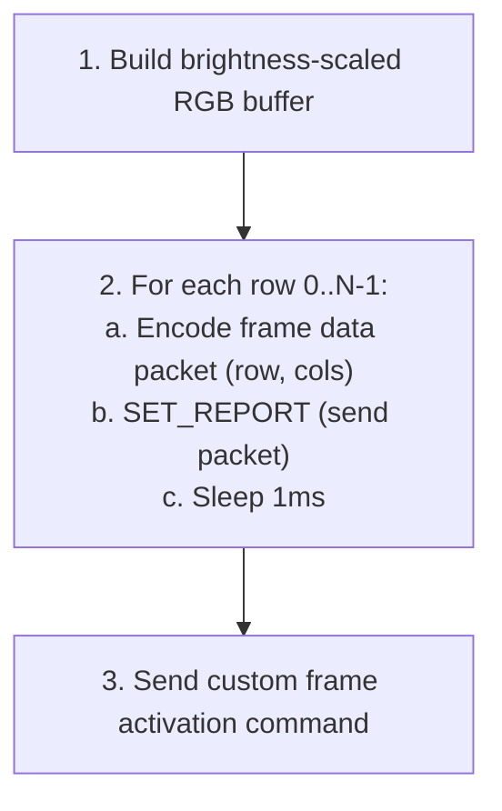
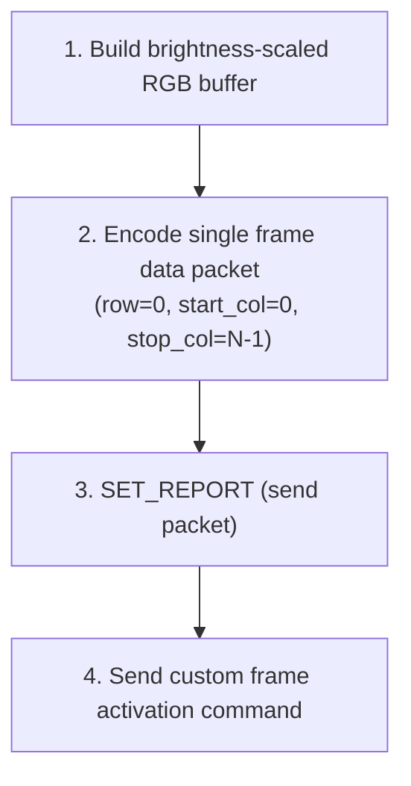

# 17 -- Razer Protocol Driver

> Native USB HID driver for Razer Chroma peripherals. Byte-level packet formats, protocol generation dispatch, matrix addressing, and clean-room integration with the HAL.

**Status:** Implemented (status corrected 2026-08-25). The 90-byte report, protocol
dispatch, CRC, and device catalog all ship in
`crates/hypercolor-hal/src/drivers/razer/`. Section 6.3 (added 2026-11-05)
records the accessory and headset registry facts. Section 7.2 (rewritten
2026-11-05) records the no-detach rule and the laptop interface layout.
**Crate:** `hypercolor-hal`
**Module path:** `hypercolor_hal::drivers::razer`
**Author:** Nova
**Date:** 2026-03-04

---

## Table of Contents

1. [Overview](#1-overview)
2. [Packet Format](#2-packet-format)
3. [Protocol Generations](#3-protocol-generations)
4. [Command Reference](#4-command-reference)
5. [Matrix Addressing](#5-matrix-addressing)
6. [Target Devices](#6-target-devices)
7. [HAL Integration](#7-hal-integration)
8. [Render Pipeline](#8-render-pipeline)
9. [Testing Strategy](#9-testing-strategy)

---

## 1. Overview

Native USB HID driver for Razer peripherals via the `hypercolor-hal` abstraction layer. All Razer Chroma devices share a common 90-byte HID feature report protocol, differentiated by a transaction ID byte that selects between protocol generations.

Clean-room implementation derived from publicly available protocol knowledge:

- OpenRGB's `RazerController` (C++)
- openrazer wiki reverse-engineering documentation
- uchroma's Rust HID report builder and Python protocol abstractions

**Vendor ID:** `0x1532` (Razer Inc.)

Feature reports travel as HID class requests on the default control pipe, not as interrupt endpoint traffic. Hypercolor sends them through the host HID stack and never claims the interface that carries them, because on every Razer family that interface is also a live input interface (section 7.2).

Older Kraken headsets (Kraken 7.1 Chroma, V2, Tournament Edition, Ultimate, Kitty V2) are the exception: they expose lighting as a RAM register map written through a 37-byte HID output report. Spec 83 covers that protocol.

---

## 2. Packet Format

Every Razer command is a 90-byte (`0x5A`) HID feature report with the following layout:

```
Offset  Size  Field               Description
──────  ────  ──────────────────  ──────────────────────────────────────────
  0       1   status              0x00 on send; response code on read
  1       1   transaction_id      Protocol version selector (see §3)
  2       2   remaining_packets   LE u16 — multi-packet sequences (usually 0x0000)
  4       1   protocol_type       Always 0x00
  5       1   data_size           Number of valid bytes in arguments field
  6       1   command_class       Command class (0x00, 0x03, 0x07, 0x0F)
  7       1   command_id          Command ID within class
  8      80   arguments           Payload data (zero-padded beyond data_size)
 88       1   crc                 XOR checksum
 89       1   reserved            Always 0x00
```

### USB Control Transfer Parameters

On the wire each report is one HID class request on the default control pipe:

| Operation         | bmRequestType | bRequest | wValue   | wIndex           |
| ----------------- | ------------- | -------- | -------- | ---------------- |
| SET_REPORT (send) | `0x21`        | `0x09`   | `0x0300` | interface number |
| GET_REPORT (recv) | `0xA1`        | `0x01`   | `0x0300` | interface number |

The `wValue` encodes `(HID_REPORT_TYPE_FEATURE << 8) | report_id` where `report_id = 0x00` for all standard devices. Some devices (Leviathan V2) use `report_id = 0x07`, yielding `wValue = 0x0307`.

These are the requests the device sees. Registered descriptors never build them directly: the host HID stack issues them for a feature report written to the device's HID collection (section 7.2).

### CRC Calculation

XOR fold of bytes `2..=87` (86 bytes): `remaining_packets` through the last
argument byte. The status byte and the transaction ID are not covered, so two
reports that differ only in transaction ID carry the same checksum.

```rust
/// Compute Razer report CRC: XOR of bytes 2 through 87, stored at offset 88.
pub fn razer_crc(buf: &[u8; 90]) -> u8 {
    buf[2..88].iter().fold(0u8, |acc, &b| acc ^ b)
}
```

OpenRazer's `razer_calculate_crc` uses the same window. The CRC byte is stored at offset 88 before transmission.

For performance, the implementation may use 8-byte-at-a-time XOR folding via `u64` reinterpretation (reference: uchroma's `fast_crc_impl`).

### Response Status Codes

| Value  | Status      | Action                                 |
| ------ | ----------- | -------------------------------------- |
| `0x00` | Unknown     | Treat as error                         |
| `0x01` | Busy        | Retry up to 3× with 100ms backoff      |
| `0x02` | Ok          | Success — read response data from args |
| `0x03` | Fail        | Error — command rejected               |
| `0x04` | Timeout     | Retry up to 3× with 100ms backoff      |
| `0x05` | Unsupported | Command not supported (non-fatal)      |

---

## 3. Protocol Generations

Razer devices span multiple protocol generations, distinguished by the `transaction_id` byte. This byte is fixed per device model, but it does not uniquely determine the lighting command family. Some devices mix a newer transaction ID with the older standard LED command set.

```rust
/// Razer protocol generation, determined by transaction_id.
#[derive(Debug, Clone, Copy, PartialEq, Eq, Hash)]
pub enum RazerProtocolVersion {
    /// Legacy protocol — transaction_id 0xFF.
    /// Older Chroma devices (BlackWidow 2014, DeathAdder Chroma).
    Legacy,

    /// Extended transaction family — transaction_id 0x3F.
    /// Huntsman V2, BlackWidow V3, Cynosa V2, Seiren Emote.
    Extended,

    /// Modern transaction family — transaction_id 0x1F.
    /// Basilisk V3, Cobra Pro, Blade 2021+, newest peripherals.
    Modern,

    /// Wireless keyboard transaction family — transaction_id 0x9F.
    /// DeathStalker V2 Pro wireless, Huntsman V2 wireless.
    WirelessKb,
}

impl RazerProtocolVersion {
    /// Transaction ID byte written to packet offset 1.
    pub fn transaction_id(self) -> u8 {
        match self {
            Self::Legacy     => 0xFF,
            Self::Extended   => 0x3F,
            Self::Modern     => 0x1F,
            Self::WirelessKb => 0x9F,
        }
    }
}

/// Lighting command family used for color/effect/brightness packets.
#[derive(Debug, Clone, Copy, PartialEq, Eq, Hash)]
pub enum RazerLightingCommandSet {
    /// Standard LED commands (`0x03` class).
    Standard,
    /// Extended matrix commands (`0x0F` class).
    Extended,
}
```

### Transaction ID Mapping Table

| Transaction ID | Transaction Family | Lighting Command Family | Example Devices                                         |
| -------------- | ------------------ | ----------------------- | ------------------------------------------------------- |
| `0xFF`         | Legacy             | Standard (`0x03`)       | BlackWidow 2014, DeathAdder Chroma, Mamba 2015          |
| `0x3F`         | Extended           | Extended (`0x0F`)       | Huntsman V2, BlackWidow V3, Cynosa V2                   |
| `0x3F`         | Extended           | Extended (`0x0F`)       | Seiren Emote (transported as 4 × 16, reported as 8 × 8) |
| `0x1F`         | Modern             | Extended (`0x0F`)       | Basilisk V3, Cobra Pro, Viper V3                        |
| `0x1F`         | Modern             | Standard (`0x03`)       | Blade 15 (Late 2021 Advanced), some laptop keyboards    |
| `0x9F`         | Wireless KB        | Extended (`0x0F`)       | DeathStalker V2 Pro (wireless), Huntsman V2 (wireless)  |

---

## 4. Command Reference

### 4.1 Command Classes

| Class  | Purpose                          | Protocols                                                                                            |
| ------ | -------------------------------- | ---------------------------------------------------------------------------------------------------- |
| `0x00` | Device info, mode, polling rate  | All                                                                                                  |
| `0x03` | Standard LED control & effects   | Legacy plus standard-command modern devices (for example Blade laptops)                              |
| `0x04` | DPI / mouse sensor               | All (mice only)                                                                                      |
| `0x05` | Profile management               | All                                                                                                  |
| `0x07` | Power / battery                  | All (wireless only)                                                                                  |
| `0x0F` | Extended matrix effects & frames | Devices using the extended lighting command family across `0x3F`, `0x1F`, and `0x9F` transaction IDs |

### 4.2 Device Info Commands (Class 0x00)

| Command              | ID     | Data Size | Arguments                  |
| -------------------- | ------ | --------- | -------------------------- |
| Get firmware version | `0x81` | 2         | — (response: major, minor) |
| Get serial number    | `0x82` | 22        | — (response: ASCII string) |
| Set device mode      | `0x04` | 2         | `[mode, 0x00]`             |
| Get device mode      | `0x84` | 2         | —                          |

**Device mode values:**

- `0x00` — Hardware mode (device runs its own effects)
- `0x03` — Software/driver mode (host controls lighting)

### 4.3 Standard LED Commands (Class 0x03 — Legacy)

| Command               | ID     | Data Size | Arguments                                  |
| --------------------- | ------ | --------- | ------------------------------------------ |
| Set LED brightness    | `0x03` | 3         | `[varstore, led_id, brightness]`           |
| Get LED brightness    | `0x83` | 3         | `[varstore, led_id, —]`                    |
| Set LED color         | `0x01` | 5         | `[varstore, led_id, R, G, B]`              |
| Set effect (activate) | `0x0A` | varies    | `[effect_id, ...]`                         |
| Custom frame (matrix) | `0x0B` | varies    | `[0xFF, row, start_col, stop_col, RGB...]` |
| Custom frame (linear) | `0x0C` | 50        | `[start_col, stop_col, RGB...]`            |

### 4.4 Extended Matrix Commands (Class 0x0F — Extended/Modern)

| Command           | ID     | Data Size | Arguments                                        |
| ----------------- | ------ | --------- | ------------------------------------------------ |
| Set brightness    | `0x04` | 3         | `[varstore, led_id, brightness]`                 |
| Get brightness    | `0x84` | 3         | `[varstore, led_id, —]`                          |
| Set effect        | `0x02` | varies    | `[varstore, led_id, effect_id, ...]`             |
| Custom frame data | `0x03` | varies    | `[0x00, 0x00, row, start_col, stop_col, RGB...]` |

**Extended effect IDs (class 0x0F, command 0x02):**

| Effect ID | Name           | Additional Args            |
| --------- | -------------- | -------------------------- |
| `0x00`    | Off / None     | —                          |
| `0x01`    | Static         | R, G, B                    |
| `0x02`    | Breathing      | mode, [R, G, B, ...]       |
| `0x03`    | Spectrum Cycle | —                          |
| `0x04`    | Wave           | direction byte             |
| `0x05`    | Reactive       | speed, R, G, B             |
| `0x08`    | Custom Frame   | — (activates per-key mode) |

### 4.5 Storage Flags

| Flag       | Value  | Behavior                                          |
| ---------- | ------ | ------------------------------------------------- |
| `NOSTORE`  | `0x00` | Ephemeral — lost on power cycle or USB disconnect |
| `VARSTORE` | `0x01` | Persisted to device flash memory                  |

Hypercolor uses `NOSTORE` exclusively for real-time rendering. `VARSTORE` is reserved for user-initiated "save to device" operations.

### 4.6 LED ID Constants

| Constant       | Value        | Used By                               |
| -------------- | ------------ | ------------------------------------- |
| `ZERO_LED`     | `0x00`       | Mice (Basilisk V3, DeathAdder, Viper) |
| `SCROLL_WHEEL` | `0x01`       | Mice (standalone scroll LED)          |
| `BATTERY`      | `0x03`       | Wireless devices                      |
| `LOGO`         | `0x04`       | Mice, headsets (standalone logo LED)  |
| `BACKLIGHT`    | `0x05`       | All keyboards (key matrix backlight)  |
| `MACRO`        | `0x07`       | Keyboards with macro keys             |
| `RIGHT_SIDE`   | `0x10`       | Laptops (right LED strip)             |
| `LEFT_SIDE`    | `0x11`       | Laptops (left LED strip)              |
| `ARGB_CH_1..6` | `0x1A..0x1F` | ARGB controller channels              |

---

## 5. Matrix Addressing

Razer devices use row/column addressing for their LED matrices. The frame data commands carry per-row LED data segments.

### 5.1 Matrix Types

```rust
/// Matrix addressing mode for a Razer device.
#[derive(Debug, Clone, Copy, PartialEq, Eq)]
pub enum RazerMatrixType {
    /// No per-key matrix — use single-color or zone effects only.
    None,

    /// Standard matrix — command class 0x03, id 0x0B.
    /// Older keyboards (BlackWidow 2016, Ornata).
    Standard,

    /// Extended matrix — command class 0x0F, id 0x03.
    /// Modern keyboards and mice (Huntsman V2, Basilisk V3).
    Extended,

    /// Linear (single-row) — command class 0x03, id 0x0C.
    /// Strips, mousepads, single-zone accessories.
    Linear,

    /// Unused. The Chroma Addressable RGB Controller registers on its own
    /// frame-report encoder (section 6.3); this variant still encodes like
    /// Extended.
    ExtendedArgb,
}
```

### 5.2 Frame Data Layouts

**Standard matrix (class 0x03, id 0x0B):**

```
args[0]    = 0xFF          (flag byte)
args[1]    = row_index
args[2]    = start_col
args[3]    = stop_col
args[4..]  = RGB data      (3 bytes per LED: R, G, B)
data_size  = (stop_col - start_col + 1) * 3 + 4
```

**Extended matrix (class 0x0F, id 0x03):**

```
args[0]    = 0x00          (reserved)
args[1]    = 0x00          (reserved)
args[2]    = row_index
args[3]    = start_col
args[4]    = stop_col
args[5..]  = RGB data      (3 bytes per LED: R, G, B)
data_size  = (stop_col - start_col + 1) * 3 + 5
```

**Linear (class 0x03, id 0x0C):**

```
args[0]    = start_col
args[1]    = stop_col
args[2..]  = RGB data
data_size  = 0x32 (50 bytes fixed)
```

### 5.3 Packet Capacity

The arguments field is 80 bytes. After header bytes, the maximum LED data per packet:

| Matrix Type | Header Bytes | RGB Capacity     | Max LEDs/Packet |
| ----------- | ------------ | ---------------- | --------------- |
| Standard    | 4            | 76 bytes         | **25 LEDs**     |
| Extended    | 5            | 75 bytes         | **25 LEDs**     |
| Linear      | 2            | 50 bytes (fixed) | **16 LEDs**     |

For keyboards with more than 25 columns, each row must be split across multiple packets.

### 5.4 Multi-Row Frame Commit Sequence

For a full-frame update on a keyboard (e.g., 6×22 Huntsman V2):

```
1. For each row 0..5:
   a. Build frame data packet with (row, 0, 21, RGB[0..21])
   b. Send SET_REPORT
   c. Sleep 1ms
2. Send custom frame activation:
   - Extended: class 0x0F, id 0x02, args [NOSTORE, led_id, 0x08]
   - Standard: class 0x03, id 0x0A, args [0x05, NOSTORE]
```

---

## 6. Target Devices

### 6.1 Priority Devices (Bliss's Hardware)

#### Razer Huntsman V2 (Full-Size)

| Field      | Value                         |
| ---------- | ----------------------------- |
| PID        | `0x026C`                      |
| Protocol   | Extended (`0x3F`)             |
| Matrix     | Extended, 6 rows × 22 columns |
| LED ID     | `BACKLIGHT` (`0x05`)          |
| Interface  | 3                             |
| Total LEDs | 132                           |

#### Razer Basilisk V3

| Field      | Value                                                 |
| ---------- | ----------------------------------------------------- |
| PID        | `0x0099`                                              |
| Protocol   | Modern (`0x1F`)                                       |
| Matrix     | Extended, 1 row × 11 columns                          |
| LED ID     | `ZERO_LED` (`0x00`)                                   |
| Interface  | 3                                                     |
| Zones      | Logo (1 LED) + Scroll Wheel (1) + Underglow Strip (9) |
| Total LEDs | 11                                                    |

Note: The Basilisk V3 does not support hardware breathing — Hypercolor must render breathing effects in software.

#### Razer Seiren V3 Chroma

| Field     | Value                                            |
| --------- | ------------------------------------------------ |
| PID       | `0x056F` (estimated)                             |
| Protocol  | TBD — likely Modern (`0x1F`)                     |
| Matrix    | TBD — likely small LED ring, estimated 8-16 LEDs |
| LED ID    | TBD                                              |
| Interface | TBD                                              |
| Status    | **Needs USB capture verification**               |

The Seiren V3 Chroma is not present in OpenRGB or openrazer databases as of this writing. The only Seiren variant with known protocol data is the Seiren Emote (`0x0F1B`, Extended transaction family, extended lighting commands, 4 × 16 transport geometry exposed as an 8 × 8 matrix). The V3 Chroma likely uses the Modern protocol (`0x1F`) with a small LED matrix for its RGB ring. Implementation will require USB traffic capture from L-Connect or Synapse for protocol verification.

### 6.2 PID Registry (Broader Coverage)

**Keyboards:**

| Device                         | PID      | Transaction ID | Matrix   | Rows × Cols |
| ------------------------------ | -------- | -------------- | -------- | ----------- |
| BlackWidow V3                  | `0x0268` | `0x3F`         | Extended | 6 × 22      |
| BlackWidow V3 TKL              | `0x0269` | `0x3F`         | Extended | 6 × 19      |
| BlackWidow V4                  | `0x028D` | `0x3F`         | Extended | 6 × 22      |
| Huntsman V2 TKL                | `0x026B` | `0x3F`         | Extended | 6 × 19      |
| Huntsman V3 Pro                | `0x02A6` | `0x3F`         | Extended | 6 × 22      |
| Huntsman V3 Pro TKL            | `0x02A7` | `0x3F`         | Extended | 6 × 19      |
| Cynosa V2                      | `0x025E` | `0x3F`         | Extended | 6 × 22      |
| DeathStalker V2                | `0x0295` | `0x3F`         | Extended | 1 × 8       |
| DeathStalker V2 Pro (wireless) | `0x0296` | `0x9F`         | Extended | 6 × 22      |
| Ornata V3                      | `0x02A1` | `0x3F`         | Extended | 6 × 22      |

**Mice:**

| Device                    | PID      | Transaction ID | Matrix   | LEDs   |
| ------------------------- | -------- | -------------- | -------- | ------ |
| Basilisk V3 35K           | `0x00CB` | `0x1F`         | Extended | 1 × 11 |
| Basilisk V3 Pro (wired)   | `0x00AA` | `0x1F`         | Extended | 1 × 13 |
| Cobra Pro (wired)         | `0x00AF` | `0x1F`         | Extended | 1 × 11 |
| DeathAdder V3 Pro (wired) | `0x00B6` | `0x1F`         | Extended | 1 × 1  |
| Viper V3 Pro (wired)      | `0x00C3` | `0x1F`         | Extended | 1 × 6  |
| Naga V2 Pro (wired)       | `0x00C7` | `0x1F`         | Extended | 1 × 3  |

**Other:**

| Device                            | PID      | Transaction ID | Notes                                                              |
| --------------------------------- | -------- | -------------- | ------------------------------------------------------------------ |
| Seiren Emote                      | `0x0F1B` | `0x3F`         | Microphone, 4 × 16 transport geometry, reported as 8 × 8 (64 LEDs) |
| Firefly V2                        | `0x0C04` | `0x3F`         | Mousepad, 1 × 19                                                   |
| Chroma Addressable RGB Controller | `0x0F1F` | n/a            | 6 ARGB headers × 80 LEDs, 320-byte frame report on interface 1 (section 6.3) |
| Charging Pad Chroma               | `0x0F26` | `0x1F`         | 1 × 10, switched to driver mode on connect                         |

Section 6.3 covers the remaining accessories and headsets.


### 6.3 Accessory and Headset Registry Facts

This section records, per device, the facts a registration needs: the
transaction ID, the lighting command set, the matrix shape, the LED ID, and
the HID interface. Each value comes from OpenRazer's kernel driver and daemon
device tables or OpenRGB's Razer device table and detector list, at the
commits listed under References, restated here as facts. A device is
registered only when every value maps onto a packet layout this driver
already encodes.

Where OpenRGB has a device, its interface and usage selection is used,
because the rest of the catalog follows the same source and OpenRGB opens
devices through HIDAPI the way Hypercolor does. OpenRazer-only devices use
OpenRazer's facts. OpenRazer sends every accessory report as a class
`SET_REPORT` with `wIndex = 0` whichever interface its HID driver binds, so
those devices open the interface 0 node with no usage filter.

#### Registered in This Pass

All of these are unverified on hardware and carry the experimental label once
the stability field lands (Spec 89).

| Device | PID | Transaction ID | Command set | Matrix | LED ID | HID interface | Source | Protocol ID |
|---|---|---|---|---|---|---|---|---|
| Tomahawk ATX | `0x0F17` | `0x1F` | Extended | 1 × 20 | `0x00` | 0, any usage | OpenRazer | `razer/tomahawk-atx` |
| Raptor 27 | `0x0F12` | `0x1F` | Extended | 1 × 12 | `0x00` | 0, any usage | OpenRazer | `razer/raptor-27` |
| Core X Chroma | `0x0F1A` | `0x3F` | Extended | 1 × 16 | `0x00` | 2, usage `0x01`/`0x02` | OpenRGB | `razer/core-x-chroma` |
| Kraken 7.1 V2 | `0x0510` | n/a | Kraken memory access, Kylie map | 1 | n/a | 3, usage `0x0C`/`0x01` | both | `razer/kraken-v2` |
| Kraken Tournament Edition | `0x0520` | n/a | Kraken memory access, Kylie map | 1 | n/a | 3 (OpenRazer `wIndex = 3`) | OpenRazer | `razer/kraken-tournament-edition` |
| Kraken Kitty V2 (Black Edition V2) | `0x0560` | n/a | Kraken memory access, Kylie map | 1 | n/a | 3, usage `0x0C`/`0x01` | both | `razer/kraken-kitty-v2` |
| Kraken 7.1 Chroma | `0x0504` | n/a | Kraken memory access, Rainie map | 1 | n/a | 3, usage `0x0C`/`0x01` | both | `razer/kraken-7-1-chroma` |
| Chroma Addressable RGB Controller | `0x0F1F` | n/a | ARGB frame report (below) | 6 headers × 80 | n/a | 1, usage `0x0C`/`0x01` | both | `razer/chroma-argb-controller` |

The three 90-byte devices use the shared extended frame upload (class `0x0F`,
id `0x03`, declared size `5 + 3 × columns`, one row per frame), the extended
brightness command on LED `0x00`, no `SET_DEVICE_MODE`, and write-only frames.
Their apply packet is the one both references send to extended-matrix
accessories:

```
class 0x0F, id 0x02, data_size 0x0C, args [0x00 NOSTORE, 0x00 LED, 0x08 custom frame]
```

That differs from the default apply packet the shared accessory builders
send (declared size `0x06`, arguments `00 00 08 00 01`), which neither
reference uses.

The Kraken headsets reuse Spec 83's memory-access report unchanged. The Kylie
devices write the custom color at `0x1189` and the effect byte at `0x172D`.
The Kraken 7.1 Chroma keeps the custom color at `0x1189` but takes the effect
byte at `0x1008`; OpenRazer and OpenRGB agree on both addresses.

#### Already Registered

The device database listed these as researched, some under wrong product IDs,
while the HAL already claimed them through the shared builders. They need no
code, only database corrections:

| Device | PID | Transaction ID | Matrix | Database correction |
|---|---|---|---|---|
| Firefly | `0x0C00` | `0x3F` | Linear 1 × 15 | Split out of a combined "Mousepad Controller" row |
| Goliathus Chroma, Goliathus Chroma Extended | `0x0C01`, `0x0C02` | `0x3F` | 1 × 1 | Same |
| Firefly V2, Strider Chroma | `0x0C04`, `0x0C05` | `0x3F` | 1 × 19 | Same |
| Firefly Hyperflux | `0x0068` | `0x3F` | 1 × 14 | Added |
| Base Station Chroma | `0x0F08` | `0x3F` | 1 × 15 | Status only |
| Mouse Dock Chroma | `0x007E` | `0x3F` | 1 × 1 | Database used `0x0F22` |
| Mouse Dock Pro | `0x00A4` | `0xFF`, extended command set | 1 × 9 | Database used `0x0F23` |
| Mouse Bungee V3 Chroma | `0x0F1D` | `0x1F` | 1 × 8 | Duplicate row at `0x0F24` removed |
| Thunderbolt 4 and 5 Dock Chroma | `0x0F21`, `0x0F52` | `0x3F` | 1 × 12 | Status, TB5 added |
| Chroma PC Case Lighting Kit | `0x0F0E` | `0x3F` | 2 × 16 | Status only |
| Chroma Mug Holder, Core | `0x0F07`, `0x0215` | `0x3F` | 1 × 15, 1 × 9 | Added |
| Kraken Kitty Edition | `0x0F19` | `0x1F` | 1 × 4 | Database used `0x020F`, a Blade laptop |
| Nommo Chroma, Nommo Pro | `0x0517`, `0x0518` | `0x3F` | 2 × 24, 2 × 8 | Split out of a combined row |
| Leviathan V2 X | `0x054A` | `0x1F`, report ID `0x07` | 1 × 14 | Split out of a combined row |

The database's Tomahawk ATX row used `0x0F05` (Driver Fusion lists that ID as
a "Razer Chroma32") and its Hanbo row used `0x0F44`; the references place
them at `0x0F17` and `0x0F35`.

#### Held

| Device | PID | Reason |
|---|---|---|
| Hanbo Chroma | `0x0F35` | Own report layout and green-red-blue order (OpenRGB `RazerHanboController`); OpenRGB's table shape of 1 × 70 does not fit one 90-byte report |
| Kraken V3, V3 X, V3 HyperSense, Kitty V2 Pro | `0x0549`, `0x0537`, `0x0533`, `0x0554` | 13-byte output report `0x40` with its own command IDs |
| Kraken V4, Kitty V3 Pro | `0x056B`, `0x056C`, `0x0587`, `0x0588` | 64-byte report with a wireless flag byte and 52 argument bytes on usage page `0xFF14`; the `KrakenV4` transaction ID variant has no encoder for it |
| Kraken 7.1 (Classic, Classic alt) | `0x0501`, `0x0506` | Logo on/off only, no color registers |
| Kraken Kitty Black Edition | `0x0F21` | OpenRGB's ID collides with the Thunderbolt 4 Dock Chroma, which OpenRazer and Driver Fusion both place at `0x0F21` |
| Chroma Light Strip Set | `0x0F2C` | Enumerates as the Chroma Wireless ARGB Controller; OpenRGB issue 2203 holds captures nobody has decoded |
| Raptor 27, second ID | `0x0F28` | Neither reference lists it |
| Laptop Cooling Pad | `0x0F43` | No captures or protocol facts (OpenRGB request 4565) |
| PWM PC Fan Controller | `0x0F3C` | Fan controller on HID interface 1, no lighting protocol documented |
| Leviathan V2 Pro, Nommo V2, Nommo V2 Pro | `0x0548`, `0x055C`, `0x055A` | Product IDs confirmed by USB ID listings, no protocol facts |
| Barracuda X Chroma, Nari family | `0x0574`; `0x051A`, `0x051C` to `0x051F` | No protocol facts |

#### Chroma Addressable RGB Controller Frame Report

The controller enumerates three HID interfaces, each with subclass 0,
protocol 0 (no boot keyboard or mouse), and one interrupt IN endpoint. Their
report descriptors, from a `usbhid-dump` in OpenRazer issue 1357, all open a
Consumer Control (`0x0C`/`0x01`) application collection containing one
vendor usage (`0xFF00`/`0x02`), 8-bit fields, logical range 0 to 1, and no
report ID:

| Interface | Descriptor length | Report | Role |
|---|---|---|---|
| 0 | 22 bytes | Feature, 90 bytes | Shared 90-byte Razer report (modes, brightness) |
| 1 | 23 bytes | Feature, 320 bytes | ARGB frame report |
| 2 | 22 bytes | Input, 16 bytes, array | Vendor input; not used |

Interface 1 declares no input or output fields, and the kernel log in
OpenRazer issue 2015 shows `hid-generic` creating only hidraw nodes, no input
devices, on all three interfaces. Opening interface 1 through hidraw or
HIDAPI detaches nothing and shares no collection with input.

Both references send the frame report as a feature report (`SET_REPORT`,
`wValue = 0x0300`, `wIndex = 1`), 320 bytes. Through HIDAPI that is report
ID `0x00` followed by the 320 bytes, a 321-byte buffer:

| Offset | Size | Field | Value |
|---|---|---|---|
| 0 | 1 | Report selector | `0x04` for channels 0 to 4, `0x84` for channel 5 |
| 1 | 1 | Channel | 0 to 5 |
| 2 | 1 | Channel (repeated) | 0 to 5 |
| 3 | 1 | Pad | `0x00` |
| 4 | 1 | Last LED index | LED count minus one |
| 5 | 315 | Color data | R, G, B per LED, up to 105 LEDs, zero past the last LED |

OpenRGB sends all six headers on every update, each with last LED index 79
(80 LEDs), waits 1 ms before each header's report, and sends no apply packet
afterward; its Direct mode exposes each header as a resizable zone of 0 to 80
LEDs. OpenRazer sends whichever headers and lengths its caller writes, with no
pacing, and places the colors from LED 0. Neither reads a reply to the frame
report.

Brightness lives on interface 0: the extended brightness command (class
`0x0F`, id `0x04`, transaction ID `0x3F`) on LED IDs `0x1A` to `0x1F`, one
per header. OpenRGB sends all six; the OpenRazer contributor who ported the
controller found LED `0x00` had no effect. An OpenRazer maintainer notes some
Razer firmware stays dark when it powered on at 0 % brightness.

Hypercolor's encoder (`drivers/razer/argb.rs`) follows OpenRGB's update
shape: six write-only reports per frame, each carrying all 80 LEDs with last
LED index `0x4F`, 1 ms after each. The device exposes six 80-LED strip
segments, "Channel 1" through "Channel 6", because the controller cannot see
what is connected; the attachment profile binds fans, rings, or strips to
each header. It opens only interface 1, so it sends no brightness command and
relies on host-side brightness. A unit left at hardware brightness 0 would
therefore stay dark until another tool raises it; nobody has confirmed
whether that happens.

#### Source Disagreements

| Device | OpenRazer | OpenRGB | Hypercolor follows |
|---|---|---|---|
| Core X Chroma | `0x1F` | `0x3F` | OpenRGB |
| Mouse Dock Pro | 1 × 8, `SET_DEVICE_MODE` (`0x03`, transaction ID `0x3F`) before every frame | 1 × 9, no device mode | OpenRGB (already registered) |
| Laptop Stand Chroma | 1 × 16 | 1 × 15 | OpenRGB (already registered) |
| Thunderbolt 4 Dock Chroma | `0x1F` | `0x3F` | OpenRGB (already registered) |

A capture from any of these devices settles its row.

---

## 7. HAL Integration

### 7.1 Protocol Implementation

`RazerProtocol` implements the HAL `Protocol` trait as a **pure byte encoder/decoder** with zero I/O:

```rust
/// Razer protocol encoder/decoder.
///
/// Handles packet construction, CRC, and response parsing.
/// Contains no I/O — all USB communication flows through
/// the transport layer.
pub struct RazerProtocol {
    /// Protocol generation for this device.
    version: RazerProtocolVersion,
    /// Lighting command family used for non-mode packets.
    command_set: RazerLightingCommandSet,
    /// Matrix addressing mode.
    matrix_type: RazerMatrixType,
    /// Matrix dimensions (rows, columns).
    matrix_size: (u8, u8),
    /// Optional user-facing dimensions when transport geometry differs.
    reported_matrix_size: Option<(u8, u8)>,
    /// Primary LED ID for this device.
    led_id: u8,
}
```

### 7.2 Transport

Every registered Razer descriptor uses `TransportType::UsbHidApi`, backed by `hidapi`. The crate is built with its hidraw backend on Linux, so reports flow through `/dev/hidraw*` while `usbhid` stays bound; Windows and macOS use the native HID APIs. Shared-report devices use `HidRawReportMode::FeatureReport`; the Kraken memory-access headsets use output reports (Spec 83).

For a report ID of `0x00` the HID buffer is the report ID byte followed by the 90-byte report, 91 bytes in all. The HID stack carries the ID in the low byte of `wValue` and leaves it out of the data stage, so the device receives exactly the 90 bytes of section 2. Reads request a 91-byte buffer and get back the ID byte followed by the 90-byte reply, which the transport strips.

#### No-detach rule

No Razer descriptor may use a transport that claims a USB interface (`UsbControl`, `UsbHid`, `UsbBulk`, `UsbVendor`, or a driver-owned `DriverUsb` transport). On Linux a claim detaches the kernel driver, and the interface that carries the Razer feature report is a HID input interface on keyboards, mice, and laptops alike, so a claim takes that input away for as long as Hypercolor holds the device. This is the Spec 53 section 8.4 rule applied to Razer. `crates/hypercolor-hal/tests/razer_input_safety_tests.rs` enforces it for every registered Razer descriptor.

#### Laptop interface layout

Blade and Book laptops expose the internal keyboard as one USB device with three HID interfaces. Public `lsusb -v` dumps show the same layout from 2018 through 2023:

| Interface | Class / subclass / protocol | Report descriptor | Endpoint  | Role                                    |
| --------- | --------------------------- | ----------------- | --------- | --------------------------------------- |
| 0         | 3 / 1 / 1 (boot keyboard)   | 61 bytes          | `0x81` IN | Keyboard                                |
| 1         | 3 / 0 / 1 (keyboard)        | 159 bytes         | `0x82` IN | Keyboard                                |
| 2         | 3 / 0 / 2 (mouse)           | 94 bytes          | `0x83` IN | Input, plus the lighting feature report |

All three are HID class, so `usbhid` binds them by default. The lighting feature report rides interface 2 (OpenRGB targets interface 2, usage page `0x0001`, usage `0x0002` for every Blade and Book; openrazer creates its lighting controls on the mouse-protocol interface and never detaches it). A third-party HID enumeration of the Blade 15 (2018 Advanced) reports a 91-byte feature report (ID plus 90) on interface 2.

Hypercolor therefore registers every laptop with the tuple the `BlackWidow` keyboards use: interface 2, report ID `0x00`, `FeatureReport`, usage page `0x0001`, usage `0x0002`, `max_report_len` 91. Until 2026-11-05 the laptops used `UsbControl { interface: 2 }`, which detached `usbhid` from interface 2 on Linux. `crates/hypercolor-hal/tests/razer_laptop_wire_tests.rs` proves both paths put identical requests on the wire for every command the laptop protocols emit.

Dumps confirming the layout cover PIDs `0x0233`, `0x023A`, `0x0245`, `0x0246`, `0x0234`, and `0x029D`, plus three PIDs outside the registry (`0x024B`, `0x026E`, `0x02C6`). Open questions:

- No decoded interface 2 report descriptor is public, so whether Fn or media keys ride its input reports is unknown. It does not change the rule, since the interface is input either way.
- No dumps exist for `0x0205`, `0x020F`, `0x0210`, `0x0220`, `0x0224`, `0x022D`, `0x0232`, `0x0239`, `0x026A`, `0x0270`, `0x0276`, `0x028A`, or `0x028C`. They are assumed to share the layout.
- The hidraw path has not yet been run on a Blade by the Hypercolor team.

### 7.3 Device Descriptor

Each supported device is described by a static descriptor mapping VID/PID to protocol parameters:

```rust
/// Static descriptor for a known Razer device.
pub struct DeviceDescriptor {
    /// USB vendor ID.
    pub vendor_id: u16,
    /// USB product ID.
    pub product_id: u16,
    /// Human-readable device name.
    pub name: &'static str,
    /// Device family classification.
    pub family: DeviceFamily,
    /// Transport binding used to reach the device.
    pub transport: TransportType,
    /// Protocol constructor and stable identifier.
    pub protocol: ProtocolBinding,
}
```

### 7.4 Device Family

Requires a new `DeviceFamily::Razer` variant in `hypercolor-types`:

```rust
pub enum DeviceFamily {
    OpenRgb,
    Wled,
    Hue,
    Razer,  // new
    Custom(String),
}
```

### 7.5 Protocol Database Registration

```rust
// Example registration entries
razer_device!(HUNTSMAN_V2, 0x026C, "Razer Huntsman V2",
    Extended, Extended, (6, 22), 3, BACKLIGHT);
razer_device!(BASILISK_V3, 0x0099, "Razer Basilisk V3",
    Modern, Extended, (1, 11), 3, ZERO_LED);
```

---

## 8. Render Pipeline

### 8.1 Full-Frame Update (Keyboard)

For a device with an N-row matrix:



### 8.2 Single-Row Update (Mouse / Accessory)

For linear devices like the Basilisk V3:



### 8.3 Timing Budget

| Operation                  | Duration | Source                       |
| -------------------------- | -------- | ---------------------------- |
| Inter-command delay        | 7ms      | uchroma `CMD_DELAY_MS`       |
| Inter-row delay            | 1ms      | OpenRGB `SetLEDs()`          |
| Response read timeout      | 1000ms   | USB control transfer timeout |
| Busy/Timeout retry backoff | 100ms    | uchroma retry logic          |

For a 6-row keyboard at 60fps (16.6ms budget):

- 6 row packets × 1ms inter-row = 6ms
- 1 activation packet = ~1ms
- Total: ~7ms per frame — fits within the 16.6ms budget

### 8.4 Brightness Scaling

Brightness is applied host-side before frame commit. The RGB values in the frame data are pre-multiplied by the brightness factor (0.0–1.0), avoiding a separate brightness command round-trip.

For devices that only support zone-level brightness (no per-key), use the extended brightness command (class 0x0F, id 0x04) as a fallback.

---

## 9. Testing Strategy

### 9.1 Mock Transport

A mock transport records all control transfers and can replay canned responses:

```rust
/// Mock USB transport for testing.
///
/// Records SET_REPORT calls and returns pre-configured
/// GET_REPORT responses for protocol validation.
pub struct MockRazerTransport {
    /// Recorded outgoing packets.
    sent: Vec<[u8; 90]>,
    /// Pre-configured responses keyed by (command_class, command_id).
    responses: HashMap<(u8, u8), [u8; 90]>,
}
```

### 9.2 Test Categories

**CRC validation:**

- Compute CRC for known-good packets from uchroma test vectors
- Verify round-trip: build packet → compute CRC → validate CRC → pass

**Command encoding:**

- Round-trip encode/decode for all command types in §4
- Verify packet layout byte-by-byte against reference implementations
- Protocol version selection: correct transaction_id and command_class per device

**Frame data serialization:**

- Standard matrix: verify row/col addressing and RGB packing
- Extended matrix: verify 2-byte reserved prefix
- Linear: verify fixed 50-byte data_size
- Multi-row splitting when column count > 25

**Device descriptor validation:**

- All PIDs in registry resolve to valid descriptors
- Matrix size × 3 bytes fits within packet capacity constraints
- Protocol version → command class mapping is consistent

---

## References

- `~/dev/OpenRGB/Controllers/RazerController/` — C++ protocol implementation
- `~/dev/OpenRGB/Controllers/RazerController/RazerDevices.cpp` — device registry with matrix sizes
- `~/dev/uchroma/rust/hid/report.rs` — Rust report builder
- `~/dev/uchroma/rust/crc.rs` — CRC implementation (SIMD-style u64 folding)
- `~/dev/uchroma/uchroma/server/protocol.py` — protocol version abstraction
- `~/dev/uchroma/uchroma/server/commands.py` — command class/ID definitions
- openrazer wiki: Reverse Engineering USB Protocol
- OpenRazer at `477f4d6d3ab7e9deb6310d5bd3742560c5cbe80d`: `driver/razeraccessory_driver.c`
  (per-device transaction IDs, the `wIndex = 0` report path, device mode
  handling), `driver/razercommon.c` (`razer_calculate_crc`,
  `razer_send_argb_msg`), `driver/razerchromacommon.c` (extended frame and
  apply packets), `driver/razerkraken_driver.c` and `.h` (Kylie and Rainie
  address maps), and `daemon/openrazer_daemon/hardware/` (matrix dimensions)
- OpenRazer commits adding single devices: Raptor 27
  `260057fc7b9b105a1eb481b9a0f31bcc3f9c93ae`, Core X Chroma
  `b70bc11b57348972e412119a54ec4aa82898e37d`, Tomahawk ATX
  `10058dca6085d90345db7a7ddda52c444347e80e`
- OpenRGB at `4f2d8920d8e187e8e47b36ebe3c12301e23eda37`:
  `Controllers/RazerController/RazerDevices.cpp` and `.h` (device table),
  `RazerControllerDetect.cpp` (interface and usage per detector),
  `RazerController/RazerController.cpp` (ARGB report, apply packet),
  `RazerHanboController/`, `RazerKrakenController/`,
  `RazerKrakenV3Controller/`, `RazerKrakenV4Controller/`
- OpenRazer issues 1357 (`usbhid-dump` report descriptors and the port of
  the ARGB frame report), 1845 (`lsusb -v` interface descriptors), 2015
  (kernel log binding `hid-generic` to hidraw only), and 2270 (brightness
  note) for the Chroma Addressable RGB Controller
- OpenRGB issue 2203 (Chroma Wireless ARGB Controller captures) and issue
  4565 (Laptop Cooling Pad request)
- linux-usb.org `usb.ids` and Driver Fusion's HID listings for product ID
  confirmation (Nari family, Leviathan V2 Pro, Nommo V2 and V2 Pro, `0x0F05`,
  `0x0F28`)
- Blade laptop `lsusb -v` dumps in openrazer issues 605 (`0x0233`), 775
  (`0x023A`), 855 (`0x0245`), 859 and 971 (`0x0246`), 910 (`0x0234`), and
  2102 (`0x029D`), which record the interface layout in section 7.2
- OpenRGB `RazerControllerDetect.cpp` (laptop detectors: interface 2, usage
  page `0x0001`, usage `0x0002`)
- dvalfrid/rigstats issue 510 (feature report enumeration on the Blade 15
  2018 Advanced: interface 2, 91 bytes)
- Spec 53 section 8.4 (input device safety)
